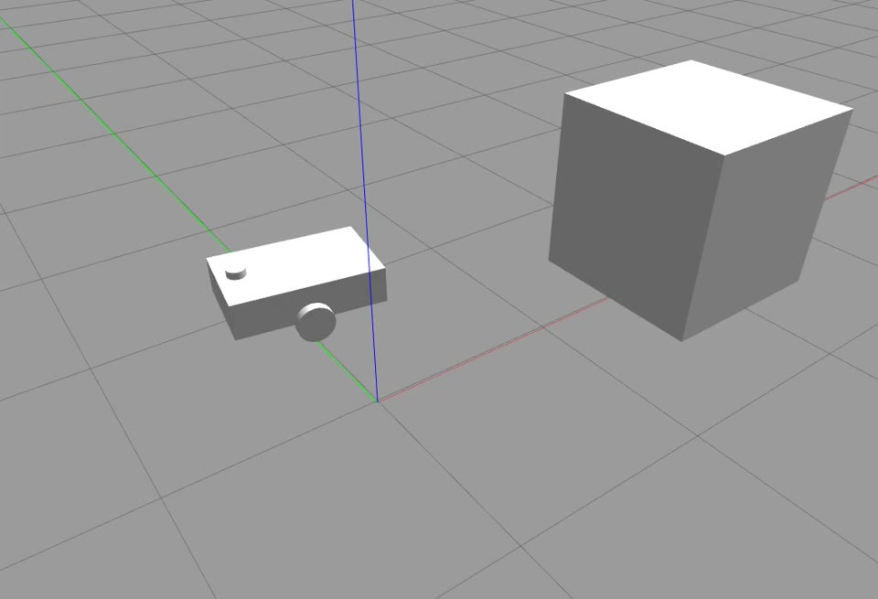
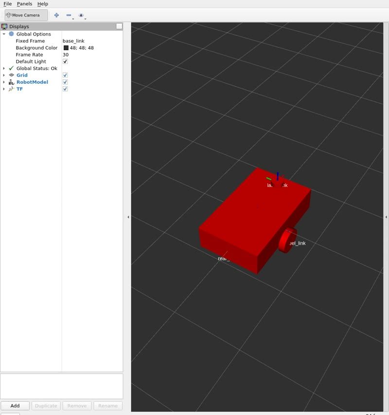
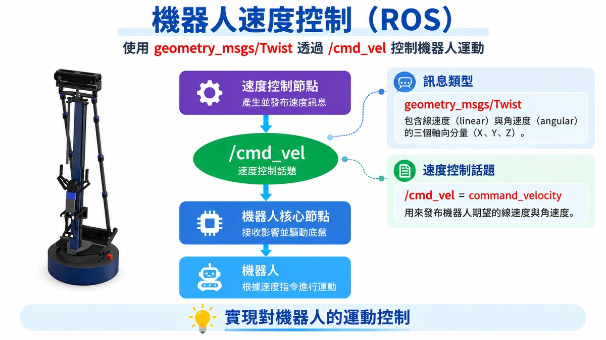
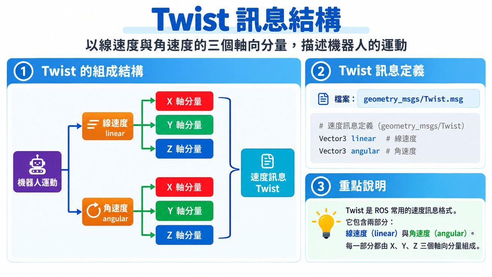
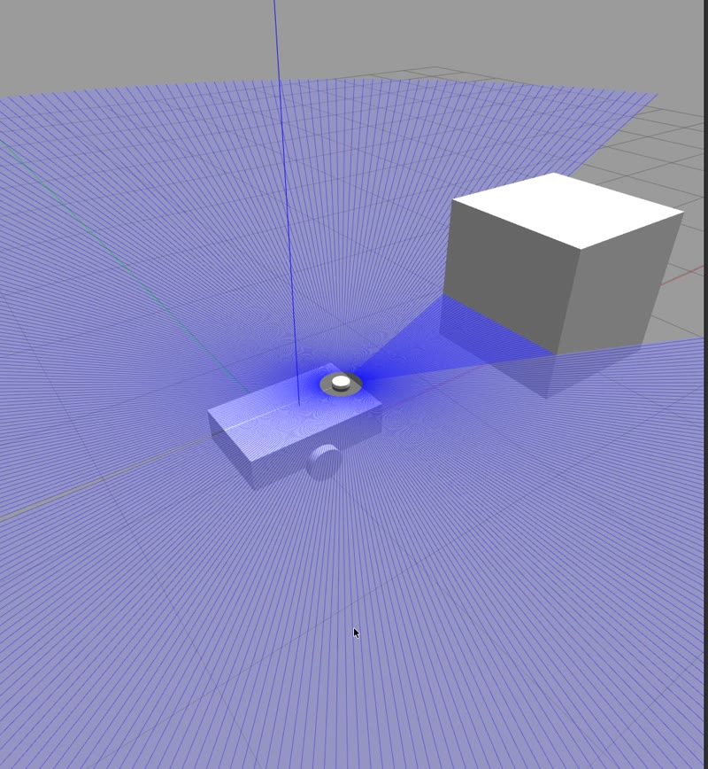

# ROS Noetic 機器人學習與實作

本專案記錄 ROS Noetic 從基礎通訊、Gazebo 模擬、RViz、LiDAR、IMU，
一路延伸到 TF、Odometry、SLAM 與 Navigation 的學習與實作過程。

重點不是單純執行既有套件，而是透過自己建立 Node、Topic、Message、
Gazebo 小車與 Sensor，理解移動機器人系統中的實際資料流與控制流程。

目前已完成：

- 自己撰寫的 ROS C++ Node（Publisher / Subscriber、`/cmd_vel` 控制、LiDAR 避障、IMU 姿態解析）
- 自己用 URDF 建立的 Gazebo 差速小車 `simple_robot`
- 自己在小車上加入 LiDAR（`/scan`）與 IMU（`/imu/data`）Sensor

後續會延伸到 TF、Odometry、Cartographer 與 Navigation。

## 畫面預覽

| Gazebo：自己建立的 simple_robot | RViz：RobotModel 與 TF |
|---|---|
|  |  |

---

## 目前學習內容

- [x] ROS Noetic 環境與基本工具
- [x] Workspace / Package
- [x] C++ Node
- [x] Publisher / Subscriber / Topic
- [x] Launch
- [x] Gazebo 小車模擬
- [x] /cmd_vel 速度控制
- [x] RViz 資料視覺化
- [x] LiDAR / LaserScan
- [x] 基礎避障
- [x] IMU / sensor_msgs/Imu
- [x] Quaternion → Roll / Pitch / Yaw
- [x] OccupancyGrid 柵格地圖 / 自訂 /map 發布
- [ ] TF / Frame
- [ ] Odometry
- [ ] Cartographer
- [ ] Localization
- [ ] Navigation

---

## 核心資料流

### 小車控制

```text
控制 Node / rqt_robot_steering
↓
/cmd_vel
↓
Gazebo Diff Drive Plugin
↓
左右輪
↓
機器人移動
```



`/cmd_vel` 使用 `geometry_msgs/Twist`，平面機器人主要使用 `linear.x`（前進速度）與 `angular.z`（轉向角速度）：



### LiDAR

```text
Gazebo LiDAR
↓
/scan
↓
sensor_msgs/LaserScan
↓
Subscriber
↓
ranges[]
↓
障礙物距離判斷
```



Gazebo 中的 360° LiDAR 掃描（藍色雷射線），前方方塊為測試用障礙物。

### IMU

```text
Gazebo IMU
↓
/imu/data
↓
sensor_msgs/Imu
↓
Quaternion
↓
Roll / Pitch / Yaw
```

### 地圖

```text
nav_msgs/OccupancyGrid
↓
/map
↓
RViz Map
```

---

## 專案結構

```text
ros_noetic_robot_learning/
├── ros_learning_pkg/
│   ├── launch/      # 啟動 Gazebo 與 ROS Node
│   ├── src/         # C++ Node
│   ├── urdf/        # simple_robot 與 Sensor 定義
│   ├── worlds/      # Gazebo 測試場景
│   ├── CMakeLists.txt
│   └── package.xml
│
└── docs/
    └── ROS_Noetic_核心學習主線/   # 各章節學習筆記：概念、指令、資料流與實作紀錄
```

---

## 執行環境

```text
Windows + WSL2
Ubuntu 20.04
ROS Noetic
Gazebo Classic 11
RViz
C++
Catkin
```

Workspace：

```text
~/ros_learning_ws
```

將 `ros_learning_pkg` 放到 `~/ros_learning_ws/src/` 底下即可編譯。

---

## 基本執行方式

### 編譯

```bash
cd ~/ros_learning_ws
catkin_make
source devel/setup.bash
```

### 啟動 Gazebo

```bash
roslaunch ros_learning_pkg gazebo_robot.launch
```

### 手動控制

```bash
rosrun rqt_robot_steering rqt_robot_steering
```

### 查看 LiDAR

```bash
rostopic echo /scan
```

### 查看 IMU

```bash
rostopic echo /imu/data
```

### IMU 姿態解析 Node

```bash
rosrun ros_learning_pkg imu_subscriber_node
```

---

## 學習筆記

`docs/ROS_Noetic_核心學習主線/` 依章節記錄每個主題，逐步整理成：

```text
概念
↓
ROS Message / Topic
↓
程式實作
↓
Gazebo / RViz 驗證
↓
實戰對照
↓
學習結論
```

| 章節 | 主題 |
|---|---|
| 01 | ROS Noetic 安裝、環境、Master 與基本工具 |
| 02 | Workspace、Package 與套件來源 |
| 03 | C++ Node 從零建立 |
| 04 | Publisher / Subscriber 與 Topic |
| 05 | Launch 與多 Node 啟動 |
| 06 | Gazebo 模擬與 cmd_vel 速度控制 |
| 07 | RViz 操作與 ROS 資料視覺化 |
| 08 | LiDAR LaserScan 資料取得與基礎避障 |
| 09 | IMU 資料取得與 Quaternion 姿態解析 |
| 10 | OccupancyGrid 柵格地圖訊息結構與自訂地圖發布 |
